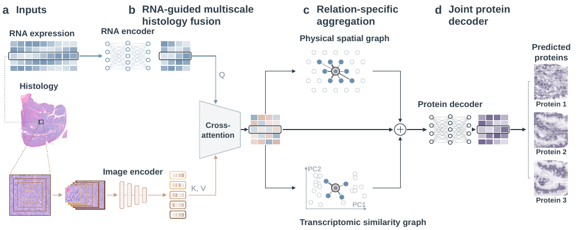

# MorphoProt

**RNA-conditioned integration of multiscale histology for spatial protein inference**

MorphoProt predicts spot-level protein abundance from spatial transcriptomics. For each
spot it combines:
- the RNA profile;
- five H&E fields of view centered on the spot, weighted by the RNA representation through cross-attention;
- two neighborhood graphs (physical and transcriptomic), aggregated with gated GATv2 blocks.



## Installation

```bash
git clone https://github.com/<account>/MorphoProt.git
cd MorphoProt
conda create -n morphoprot python=3.11 -y && conda activate morphoprot
pip install torch --index-url https://download.pytorch.org/whl/cu121   # pick the build for your CUDA
pip install -r requirements.txt
python tests/test_smoke.py      # CPU, random data, about 1 minute
```

## Data

| Tissue | Train → test sections | Source |
|---|---|---|
| Human tonsil | female → male (29 proteins) | 10x Genomics, *CytAssist FFPE Human Tonsil (Protein Expression)* datasets |
| Mouse spleen | replicate 1 → replicate 2 (21 proteins) | SPOTS, GEO [GSE198353](https://www.ncbi.nlm.nih.gov/geo/query/acc.cgi?acc=GSE198353) |
| Human liver | N123, N126 → Sah73, Sah80 (31 proteins) | GEO [GSE278662](https://www.ncbi.nlm.nih.gov/geo/query/acc.cgi?acc=GSE278662) |

| Step | Script |
|---|---|
| Tonsil RNA (3,500 training HVGs, log1p, train-fitted z-score) and protein (log1p, z-score separately within each section) | `preprocessing/preprocess_tonsil.py --gene-list gene_lists/tonsil_genes_3500.txt` |
| Spleen RNA (3,500 training HVGs, genes of the measured proteins always kept), protein and hires coordinates | `preprocessing/preprocess_spleen.py --gene-list gene_lists/spleen_genes_3500.txt` |
| Liver RNA (same recipe as spleen) and protein | `preprocessing/preprocess_liver.py --gene-list gene_lists/liver_genes_3500.txt` |
| Tonsil UNI2-H features, 256–1,280 px fields | `preprocessing/extract_features_tonsil_uni2h.py` (needs access to [MahmoodLab/UNI2-h](https://huggingface.co/MahmoodLab/UNI2-h)) |
| Spleen / liver ResNet18 features, 16–128 px hires fields | `preprocessing/extract_features_spleen_resnet18.py`, `preprocessing/extract_features_liver_resnet18.py` |

`gene_lists/` holds the 3,500 input genes of each tissue in model column order. Pass
the list with `--gene-list` to reproduce the paper inputs exactly; without it, the genes are
reselected from the training section, and their membership and order can depend on the scanpy version. It also
lists the protein-coding genes that are always kept.

For tonsil, dynamic HVG selection retains genes detected in at least **3 training
spots**, then selects 3,500 HVGs from normalized, log-transformed training RNA.


For spleen and liver, each ResNet18 field (16, 32, 64, 96 or 128 hires pixels)
is resized in full to **224 x 224** with PIL bilinear interpolation before
conversion to [0, 1] and ImageNet mean/std normalization. No center crop is
applied. Extraction summaries record the encoder input size and interpolation.

Point `MORPHOPROT_DATA` at a folder with this layout. It defaults to `./data`.

```
data/
├── tonsil/{female,male}/
│   ├── gene/   tonsil{woman,man}_..._hvg3500_seurat_gene_zscore_log1p_raw.h5ad
│   ├── pro/    tonsil{woman,man}_pro_filter_log1p_zscore.h5ad
│   ├── coord/  tissue_positions_intersect_ordered.csv
│   └── image_uni2h_*/  tonsil{woman,man}_uni2h_patch{256,...,1280}.npy
├── spleen/
│   ├── _scheme2_log1p_zscore_hvg3500_force_marker_in_tissue1/   RNA: X_{train,test}_log1p_zscore.npy, {train,test}_barcodes.txt
│   ├── _protein_scheme_log1p_zscore_in_tissue1/                 protein: Y_{train,test}_log1p_zscore.npy, protein_names.txt
│   ├── _hires_resnet18_multiscale512/                           image: he_resnet18_ps{16,...,128}_{train,test}_512.npy
│   └── Dataset{1,2}_Mouse_Spleen{1,2}/tissue_positions_list_with_hires_coords.csv
└── liver/
    ├── _scheme2_log1p_zscore_hvg3500_force_marker_in_tissue1/   RNA: X_{train,test}_log1p_zscore.npy, {train,test}_barcodes.txt,
    │                                                            {train,test}_tissue_positions_with_hires_coords.csv
    ├── _protein_scheme_log1p_zscore_in_tissue1/                 protein: Y_{train,test}_log1p_zscore.npy, protein_names.txt
    ├── _hires_resnet18_multiscale512/                           image: he_resnet18_ps{16,...,128}_{train,test}_512.npy
    └── samples/{N123,N126,Sah73,Sah80}/                         tissue_hires_image.png, tissue_positions_list_with_hires_coords.csv
```

All three tissues are written in this layout by the scripts in `preprocessing/`. In spleen the
coordinates sit in the section folders; in liver they are in the RNA folder, and `samples/` holds
the hires images that the liver feature extractor reads.

## Training and evaluation

All models use seeds 42, 99, 7 and 1024, with 15% of training-section spots held out for
validation. The checkpoint is chosen by validation mean SCC. The four seed predictions are
averaged before protein-wise SCC, PCC and RMSE are computed.

```bash
python morphoprot/train_tonsil_spleen.py --datasets tonsil spleen \
    --ablations full rna rna_image rna_graph --seeds 42 99 7 1024

python morphoprot/train_liver.py --seeds 42 99 7 1024
```

Outputs go to `results/tonsil_spleen/` and `results/liver/` (or `MORPHOPROT_RESULTS`).
They include per-seed predictions, per-protein metrics and the four-seed ensemble.

## Repository structure

```
morphoprot/
  core.py                 model (DualGATv2GraphModel), graph construction, training loop, tonsil data loading
  data_spleen.py          spleen data loading
  data_liver.py           liver data loading
  train_tonsil_spleen.py  entry point: tonsil and spleen, with modality ablations
  train_liver.py          entry point: liver
  paths.py                data / results locations (MORPHOPROT_DATA, MORPHOPROT_RESULTS)
preprocessing/            preprocess_{tonsil,spleen,liver}.py, extract_features_*.py
gene_lists/               input genes and always-kept protein genes per tissue
tests/test_smoke.py       CPU test on random data
docs/                     overview figure
```

## License

MIT. The datasets and the UNI2-H weights keep their own licenses.
